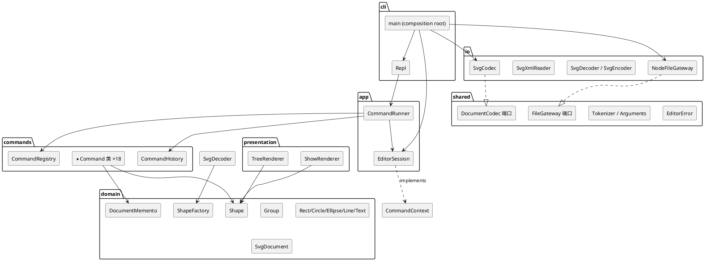

# Lab1 Phase 1 架构文档：SVG 编辑器 CLI

> 本文是 `doc/README.md`，对应提交要求的三节：**架构方案**、**过程记录**、**一致性自查**、**质量保证手段**。
> 文中所有依赖结论都可在 `src/` 中按 `path:line` 复核；一致性自查一节给出了复核命令。

---

## 1. 架构方案

### 1.1 模块划分

```text
src/
├── shared/         零业务知识的基础设施：错误类型、数字格式化、XML 转义、分词、参数游标、文件端口
├── domain/         图形模型（本项目的核心，不依赖任何人）
│   ├── Shape        抽象基类：id、绘制属性、父链接、set 白名单、moveBy/scaleBy
│   ├── Group        Composite：既是 Shape 又是容器
│   ├── Rect / Circle / Ellipse / Line / Text   五个叶子
│   ├── SvgDocument  文档根，实现 ShapeContainer 但可寻址性为零
│   ├── ShapeFactory 类型名 → 类的唯一分派点
│   └── DocumentMemento  undo 快照
├── commands/        每条命令一个类（Command 模式），含 undo/redo；CommandRegistry 是第二个分派点
├── io/              SVG 解析 / 序列化 / node:fs 适配器（唯一接触文件系统的地方）
├── app/             用例编排：EditorSession（文档与 id 解析）、CommandRunner（跨命令规则）
├── cli/             REPL 与进程入口（组合根）
└── presentation/    tree / show 的文本渲染
```

每个模块的职责，以及它**为什么存在**（而不是被合并到邻居里）：

| 模块 | 职责 | 单独存在的理由 |
|---|---|---|
| `shared` | 与业务无关的机械功能 | 这些功能被上下三层共用；放进任一层都会制造反向依赖 |
| `domain` | 图形是什么、能做什么（几何、层级、属性白名单、序列化形状） | 全项目的依赖汇点；必须能在没有 fs / 没有 console 的情况下被测试与复用 |
| `commands` | 用户意图是什么，以及如何撤销 | undo/redo 是**变更语义**，不是模型状态；放进 domain 会让模型背负编辑历史 |
| `io` | 字节 ↔ 模型 | 文件格式是外部关注点，将来可能增加 JSON / 其他方言 |
| `app` | 一次会话的生命周期与跨命令规则 | “哪条命令要进 undo 栈”“io 之后锁 history”不属于任何单条命令 |
| `cli` | 输入输出与进程边界 | 是唯一允许 `console` / `process` / `error:` 前缀的地方 |
| `presentation` | 文本视图 | `tree` 的列对齐是展示逻辑；放进 domain 会把 `padEnd` 写进模型 |

同一张图的 PlantUML 组件图（源文件见 `doc/components.puml`）：



**关键点**：`commands` 依赖的是 **端口**（`CommandContext`、`DocumentCodec`、`FileGateway`），
不是 `io` / `app` 的具体类。所以图上 `commands` 与 `io` 之间**没有箭头**——这是刻意的。

### 1.2 设计模式的选择与落地

#### Command（题目要求，必须使用）

- **接口**：`src/commands/Command.ts` 定义 `CliCommand { execute() }` 与 `UndoableCommand extends CliCommand { undo(); redo(); }`。
- **落地**：18 个命令各占一个类一个文件（`CreateCommand`、`MoveCommand`、`GroupCommand`…），每个类自己解析参数、自己执行、自己生成成功回显与 undo/redo 回显。
- **收益**：`group g1 c1 box t1` 天然是**一个** undo 单元——因为它就是**一个对象**，无需“合并事务”的机制。
- **反例规避**：没有 `EditorSession.execute(name, args)` 里的巨型 switch；命令对象由 `CommandRegistry` 构造，会话只拿到 `CliCommand` 接口。

#### Composite（本项目的核心考查点）

- `Shape` 是 Component，`Group` 是 Composite，五个叶子是 Leaf。
- `moveBy` / `scaleBy` 在 `Shape` 中是**默认实现**（遍历自己的 `NumericAttribute` 单元格），`Group` 覆写为递归。
- 因此 `move node2 0 100` 与 `move c1 30 0` 走的是**同一条代码路径**（`MoveCommand` 里没有 `if (isContainer)` 分支来决定“怎么动”，只有分支决定“怎么回显”）。
- `Group` 的几何为空（`geometry()` 返回 `[]`），所以它**不需要** transform，也不会出现“组有坐标但子元素没动”的模型分裂。

#### Memento

- `DocumentMemento` 抓取整棵树的深拷贝；`AbstractEditCommand` 在 `apply()` 前后各抓一次。
- 选它而不是“每条命令写一个反向操作”的原因：`delete` 必须回到**原父容器、原 z-order**，`group` 必须还原 N 个图形各自的归属——反向操作要写 18 份且容易漏；快照是 1 份且不会错。
- 代价：每步 O(n) 内存。在本文档规模（几十个图形）下可忽略，已记入变化点假设。

#### Factory + Registry（唯一两处按名分派）

| 分派点 | 文件 | 作用 | 状态 |
|---|---|---|---|
| 图形工厂 | `src/domain/ShapeFactory.ts` | `rect` → `Rect` 类 | 待重构为插件注册表 |
| 命令注册表 | `src/commands/CommandRegistry.ts` | `move` → `MoveCommand` | 待重构为插件注册表 |

两处都标注了“后续插件化阶段的替换点”。除此之外**没有第三处**按名分派（一致性自查第 2 条给出复核方法）。

#### Template Method

- `AbstractEditCommand` 固化“快照 → apply → 快照，失败则回滚”的骨架，子类只实现 `apply()` / `renderUndo()` / `renderRedo()`。

#### Strategy（轻量）

- `TreeRenderer` / `ShowRenderer` 是独立的展示策略对象，`tree` / `show` 命令只持有它们；将来要加 JSON 输出或彩色输出，只加一个渲染器。

#### 明确**不**引入的模式

| 模式 | 为什么不留 |
|---|---|
| Observer / 事件总线 | 没有多个视图需要同步；REPL 是拉取式的。加了就是空转的间接层 |
| Plugin 容器（本阶段） | `box` 类型属下一阶段；本阶段预留了 `ShapeFactory` 这一个替换点，但没有提前建插件框架——那是投机性设计 |
| Visitor | 序列化在 `Shape.toSvgElement()` 里由多态完成，`tree`/`show` 用 `summary()`/`details()`。Visitor 会迫使我为每种新操作改一遍所有类 |

### 1.3 依赖方向规则

**允许的依赖（箭头表示“可以 import”）**：

```text
cli  →  app  →  commands  →  domain
 │       │         │           ↑
 │       │         └───────────┤
 │       └─────────────────────┤
 └──→  io  ────────────────────┘
        ↑
     shared  ←（所有层都可以依赖）
```

| 规则 | 理由 |
|---|---|
| `domain` **不依赖任何模块**（除 `shared`） | 它是依赖汇点。一旦 domain 认识 fs 或命令名，模型就无法在没有 IO 的情况下测试，也无法被第二阶段（GUI）复用 |
| `commands` 可以依赖 `domain`，**不可**依赖 `io` / `app` / `cli` | 命令需要改模型；但“文件怎么读写”“会话怎么持有文档”是外部细节，通过 `CommandContext` / `DocumentCodec` / `FileGateway` 三个端口注入 |
| `io` 可以依赖 `domain`，**不可**依赖 `commands` / `cli` | 编解码器需要构造模型对象；它不该知道有哪些命令 |
| `app` 可以依赖 `commands` + `domain` + `io` | 它是编排层：唯一允许“同时认识命令和适配器”的地方（但仍然通过接口） |
| `cli` 只依赖 `app`（与组合根需要的 `io`） | CLI 是**最外层**；它把异常翻译成 `error:` 行，不做业务判断 |
| `presentation` 只依赖 `domain` | 渲染器读模型，不知道命令存在 |
| 任何模块**不得**依赖 `cli` | 否则无法在测试里驱动会话 |

**违规即待处理项**：一致性自查第 1 条给出实际检查结果。检查手段是一条可重复执行的命令（见 §4.3），而不是“我觉得没问题”。

### 1.4 变化点假设

逐条列出我认为未来最可能变化的地方，以及我为它留了什么——或者为什么决定不留。

#### ① 图形类型会变多（`box`、`hexagon`、自定义节点）

**会变**。这是题目明确预告的方向（4.4 的 `box` 属于插件化阶段）。

**留了什么**：
- `Shape` 抽象 + `ShapeFactory` 单一分派点。新增类型 = 新增一个类 + 在 `ShapeFactory.SPECS` 加一条规格；
- `CreateCommand` 完全不含类型知识：它的参数列表来自 `ShapeTypeSpec`，所以**加类型不碰命令层**；
- `Shape.setAttribute` 的白名单来自 `geometry()` + `paint` + `setOwnAttribute` 钩子，加类型不碰 `set` 命令；
- 序列化靠多态（`toSvgElement`），`read` 侧的未知标签会报 `unknown shape type`，与题目 4.2 的文案一致。

**没有留的**：真正的插件加载机制（动态 import / 外部包）。本阶段没有任何证据表明扩展需要跨进程或跨包分发，提前建插件容器是投机性设计；而且题目把“内核代码为 0”明确划到下一阶段。

#### ② 文件格式 / 持久化会变（JSON、压缩格式、云端）

**可能变**。

**留了什么**：`DocumentCodec` 端口（`decode` / `encode`）。`read` / `save` 命令只依赖端口，`SvgCodec` 是其中一个实现。换成 JSON 只需新增一个 `JsonCodec` 并在组合根替换一行。

**没有留的**：多格式自动探测（按扩展名分派）。目前没有第二个格式，加了就是死代码。

#### ③ `undo` 策略会变（从整树快照改成增量命令 / 协作编辑）

**会变，如果图形数量上升**：整树 memento 是 O(n) 内存，且每次编辑都深拷贝。

**留了什么**：撤销的实现被隔离在 `AbstractEditCommand` + `DocumentMemento` 两个类里，命令只声明“我改了模型”。改成增量命令只需要让每个命令实现一个 `invert()`，其余层（`CommandHistory`、`CommandRunner`、`app`）不动。

**没有留的**：增量撤销本身。在本阶段的文档规模下，正确性 >> 内存；且整树快照顺带解决了“delete 恢复到原 z-order”这个容易出错的地方。

#### ④ 画布尺寸表达从 `width/height` 扩展到 `viewBox` / 单位

**可能变**（SVG 天然支持 `viewBox`、`preserveAspectRatio`、绝对/相对单位）。

**留了什么**：`SvgDocument` 是唯一持有画布尺寸的类，`toSvgElement()` 集中生成 `viewBox`；`canvas` 命令只与 `SvgDocument.resize` 对话。

**没有留的**：单位系统（px/pt/mm）与视口变换。本阶段坐标系约定就是 px，加单位系统会污染所有几何运算。

#### ⑤ 输出呈现会变（彩色、JSON、给 GUI 用的结构化事件）

**会变**（第二阶段要接鼠标通道）。

**留了什么**：`presentation` 层的两个渲染器；命令返回的是 `readonly string[]` 而**不是**直接写 stdout，所以将来可以让同一个命令返回结构化对象给 GUI。

**没有留的**：把返回值抽象成 `Result` 对象。REPL 只需要字符串；提前抽象会迫使 18 个命令都改签名，收益为零。

#### ⑥ 命令语法会变（新增子命令、可选参数、批量操作）

**可能变**。

**留了什么**：`CommandSyntax.ts` 是语法的唯一来源（`usage:` 错误、`help` 都读它）；`Arguments` 游标把“取第 N 个参数”与“报用法错误”封装在一起。

**没有留的**：完整表达式语法（`select where ...`）。题目的命令集是固定动词 + 位置参数，引入解析器框架属于过度设计。

---

## 2. 过程记录

本节记录与 AI 协作中**真正卡住过**的几个点：AI 给出的第一版是什么、我怎么发现不对、怎么确认、最后怎么改。这些都对应可复现的命令或测试。

### 2.1 `geometry()` 返回临时包装对象 → `set` 静默失效

**AI 第一版**：每个叶子类把 `x/y/w/h` 存成普通 `number` 字段，同时实现 `geometry()` 返回 `[{name, get: () => this.x, set: v => this.x = v}]` 这样的**临时对象数组**。

**问题**：`set r1 width 40` 会创建一批新包装对象，写到 `setAttribute` 收到的那个对象上——写进了一个马上被丢弃的临时对象，模型值没变，但命令回显 `rect#r1 updated: width=40`。这是最危险的一类 bug：**UI 说成功了，状态没变**。

**怎么发现**：写 `tests/commands/EditCommands.test.ts` 里的 `set` 用例时，断言的是 `show r1` 的输出而不是回显。第一版直接失败（`width=10`）。

**怎么确认**：给 `Rect` 写一个最小复现——`rect.geometry()[0].set(99); rect.valueOf("x")` 返回 `10` 而非 `99`。

**修正**：把几何真正存进 `NumericAttribute` 单元格（`src/domain/NumericAttribute.ts`），形状**长期持有**这些单元格，`geometry()` 只是把它们**暴露**出去。`moveBy` / `scaleBy` / `setAttribute` 全部走单元格，因此写一定落到真实状态上。这也让“所有几何操作只有一个实现”成立。

### 2.2 `Group` 的环检测只查了一个方向 → 内存里出现环

**AI 第一版**：`insertChildAt` 检查 `this.contains(shape)`（我要放进去的东西是否已经在我的子树里），用来防“把子孙再塞给自己”。

**问题**：漏了反方向——把**祖先**塞进**后代**。`inner.insertChildAt(0, outer)`（outer 是 inner 的父亲）会通过检查，于是 outer 成为 inner 的子节点，同时 inner 仍是 outer 的子节点，树变成环；`walk()` 会无限递归。

**怎么发现**：`tests/domain/ShapeTree.test.ts` 的 “refuses to contain itself or an ancestor” 用例失败（期望抛错，实际没抛）。

**怎么确认**：这条路径在 CLI 上也可达——`addto inner outer`。当时 `AddToCommand` 的检查写反了（`container.contains(shape)` 判断的是“目标是否已在我要移动的子树里”，语义正好是另一件事），所以 CLI 上真的能把 outer 塞进 inner，输出还报成功。

**修正**：
1. `Group.insertChildAt` 同时检查 `shape.asContainer()?.contains(this)`（向上）；
2. `AddToCommand` 改为分别判断“自己”与“目标是自己的后代”两种情况，各给独立文案；
3. 补两条测试（领域层 + 命令层），并让 `addto` 的错误文案与 `group` 的保持一致风格。

**这件事的教训**：环检测必须双向，且“命令层的校验”不能替代“模型层的不变量”——两者都要有，因为模型会被未来的 GUI 通道直接调用。

### 2.3 `scale` 用 `transform="scale()"` → 模型与显示不一致

**AI 第一版**：`scale r1 2` 给元素加 `transform="scale(2)"`，理由是“SVG 就该这么干，还不用改坐标”。

**问题**：`tree` 和 `show` 显示的是 `x=10 y=20 w=100 h=50`（没变），但画面上图形已经放大并**向左上角移动**了（SVG 的 `scale` 绕原点）。用户读到的数字与看到的效果不一致；而且对 `<g>` 加 transform 后，`move` 该改 transform 还是改子元素坐标，会立刻产生两套真相。

**怎么确认**：题目 4.1 明确写 “`factor` 同乘到图形的全部几何属性（位置与尺寸）”，且 §5.1 要求 tree 内联几何属性——两条合起来就排除了 transform 方案。

**修正**：`Shape.scaleBy(factor)` 直接乘每个 `NumericAttribute`（坐标与尺寸都乘），`Group` 递归。于是 `scale r1 2` 之后 `show r1` 报 `x=20 y=40 width=200 height=100`，与画面一致。

**顺带修掉的问题**：`scale` 的负数/零要在**解析阶段**就报 `error: scale factor must be positive`（题目 4.2 的固定文案），而不是等乘完得到负宽度、再在渲染时炸掉。

### 2.4 `read` 缺 id 时静默生成 → 与约定的“必须警告”不符

**AI 第一版**：`read` 时对没有 id 的元素直接 `id = tag + 自增序号`，不打印任何东西。

**问题**：题目 §2 要求 `warning: assigned id rect1 to unnamed <rect>`。静默补 id 会让用户以为文件本来就有 id，后续 `move rect1` 的脚本在不同文件上会**静默改错对象**。

**怎么确认**：把题目 §6 的 `other.svg` 原样喂给 CLI，对比输出——少了 warning 行，且 `tree` 里的 id 与题目一致，说明只差警告这一环。

**修正**：`SvgDecoder.resolveId` 在补 id 时 push 一条 warning；`ReadCommand` 先输出 warnings 再输出 `read … (n elements)`。同时补了一条“序号要跳过文件里已存在的 id”的测试（文件里已有 `rect1` 时，下一个无名矩形必须叫 `rect2`），否则会撞 id。

### 2.5 失败的命令留下了半截状态

**AI 第一版**：`group` 先 `removeChild` 再 `insertChildAt`，校验放在中间。于是 `group bad c1 markers`（祖先环）会先把 `c1` 从 `markers` 里摘掉，然后抛错——文档结构已经变了，但用户只看到一行 `error:`。

**问题**：题目 §2 明确“命令失败不改变任何状态”。这是硬约束，且很难靠 code review 发现。

**怎么确认**：写测试时特意比较失败前后的 `tree` 输出（`StructuralCommands.test.ts` 的 “changes nothing when the group is rejected”）。第一版失败。

**修正（双保险）**：
1. `GroupCommand` 把**所有**校验前置到任何 detach 之前；
2. `AbstractEditCommand.execute()` 在 `apply()` 抛错时用 `before` 快照回滚。这样即使将来某条命令又忘了前置校验，也不会留下半截状态。

### 2.6 Memento 顺手把画布尺寸也存了 → `undo` 会缩回画布

**AI 第一版**：`DocumentMemento` 抓取了 `width` / `height` 与图形树，`restore()` 里一并 `resize`。

**问题**：`canvas 400 300` 修改尺寸之后，只要再执行一条编辑命令（解锁 undo），随后 `undo` 就会把**画布尺寸**也还原成编辑前的值。用户看到的是“我撤销了一次移动，结果画布缩回去了”。题目 §3 把 `canvas` 改尺寸归为**文档类**命令，它的效果本就不该被编辑命令的撤销拖走。

**怎么发现**：写完主流程后我逐条核对“文档类命令的副作用是否只受文档类语义控制”，构造了 `create → canvas 400 300 → create → undo` 这条路径；当时 `canvas` 报告 `800x600`，与刚设定的 `400x300` 不符。

**修正**：Memento 的职责收窄为**只快照图形树**，画布尺寸不进快照。新增 `tests/commands/DocumentBoundary.test.ts` 三条用例锁住这个边界（含“resize 后 undo 三次画布仍是新尺寸”“init 清空历史”“read 不继承旧 sourcePath”）。

**顺带修掉的**：`read` 之后 `save`（无参数）原本会沿用**上一个**文档的路径，可能覆盖用户没打算覆盖的文件。现在 `init` / `read` 都会重置 `sourcePath`。

### 2.7 测试基线建起来之后，才敢改动架构

**背景**：中途我意识到 `Line` 在 `tree` 里显示成 `x1=280 y1=130 x2=520 y2=130`，而题目 §6.1 要的是 `(280,130) -> (520,130)`；`Text` 同理要 `(155,135) "开始"`。

**做法**：先给 `summary()` 加多态覆写（`Shape.summary()` 默认拼几何，`Line`/`Text` 覆写），再跑 `tests/transcripts.test.ts`——它逐行比对题目 §6 与 §6.1 的完整输出。这一步把“我觉得像”变成了“逐字符相等”。

**结果**：两份 transcript 的每一行（包括 `├──`/`└──`/`│` 前缀与空格对齐）都与题目一致。这条测试后来成了整个项目最有价值的一条：任何改动只要破坏输出格式，它立刻红。

---

## 3. 一致性自查

### 3.1 模块划分：实际目录与方案是否一致？

**结论：一致（含 2 处已在设计阶段合并/命名的偏离，均无遗留待处理项）。**

| 方案中的模块 | 实际目录 | 状态 |
|---|---|---|
| `domain`（Shape/Group/叶子/Canvas/Factory/Memento） | `src/domain/` 14 个文件 | 一致 |
| `commands`（Command + History + Registry） | `src/commands/` 20 个文件 | 一致 |
| `io`（Reader/Writer/Codec/FileStore） | `src/io/` 5 个文件 | 一致（`FileStore` 命名为 `NodeFileGateway`，端口叫 `FileGateway`） |
| `app`（EditorSession + 工厂装配） | `src/app/` 2 个文件 | 一致；工厂按方案放在 `domain`（它构造领域对象，属于领域知识） |
| `cli`（REPL/Tokenizer/Parser/Presenter） | `src/cli/` 2 个 + `src/presentation/` 2 个 + `src/shared/Tokenizer.ts` | **偏离**：见下 |
| `shared` | `src/shared/` 6 个文件 | 方案里没有单列，实施时抽出 |

**偏离说明（已记入修订记录）**：
1. **`presentation` 从 `cli` 中拆出**：方案里 `Presenter` 在 `cli` 下。实施时发现渲染器只依赖 `domain`，若留在 `cli` 会让“展示逻辑”与“进程/IO”耦合，因此独立成层。依赖方向未变（仍只依赖 `domain`）。
2. **分词与参数游标放进 `shared`**：它们被 `cli`（解析命令行）与 `commands`（`Arguments`）共用。若留在 `cli`，`commands` 就必须依赖 `cli`——直接违反依赖方向规则，所以必须上移。

方案文档的“模块划分”一节已按实际结构更新（见 §1.1 的目录树），因此**没有未记录的不一致**。

### 3.2 依赖方向：方案里的规则有没有被违反？

**结论：无违反。** 以下是可复核的全量检查，而不是抽样。

#### 检查 1：`domain` 是否 import 了上层

```bash
# 期望：无输出（domain 只允许 import 自己和 shared）
grep -rnE "from \"\.\./(commands|app|io|cli|presentation)/" src/domain/
```

**实际**：无输出。

#### 检查 2：`commands` 是否 import 了 `io` / `app` / `cli`

```bash
grep -rnE "from \"\.\./(io|app|cli)/" src/commands/
```

**实际**：无输出。`read`/`save` 通过 `CommandContext.codec` / `.files` 拿到端口实现。

#### 检查 3：`io` 是否 import 了 `commands` / `cli`

```bash
grep -rnE "from \"\.\./(commands|cli|app)/" src/io/
```

**实际**：无输出。

#### 检查 4：`node:fs` 只出现在 `NodeFileGateway`

```bash
grep -rn "node:fs" src/ | grep -v "src/io/NodeFileGateway.ts"
```

**实际**：`src/cli/main.ts` 用 `node:fs` 读 `--script` 文件。**判定：可接受，但需说明**——组合根读脚本是启动参数处理，不是编辑器的文件语义（编辑器的文件语义在 `read`/`save`，走 `FileGateway` 端口）。已在 §1.3 的规则里注明“组合根额外依赖 `io`”。

#### 检查 5：`presentation` 只依赖 `domain`

```bash
grep -rn "from \"\.\./" src/presentation/
```

**实际**：只 import `../domain/Shape.js` 与 `../domain/SvgDocument.js`（类型）。

#### 检查 6：按名分派只有两处

```bash
grep -rnE "switch \(|\.typeName ===|instanceof (Rect|Circle|Ellipse|Line|Text)" src/
```

**实际**：`src/domain/ShapeFactory.ts` 有 `switch (type)`（工厂，允许）；`src/commands/CommandRegistry.ts` 是 `Map<string, Builder>`（注册表，允许）。其余无输出。

> 说明：`SvgDocument` 早期版本曾用 `instanceof Group` 判断顶层容器，实施中改为 `Shape.asContainer()` 多态调用，已消除该类型判断（这也是为什么 `Shape` 上有 `asContainer()` 这个钩子）。

### 3.3 命令覆盖自查

对照题目 §3 的命令总表逐条核对（`tests/` 中均有对应用例）：

| 命令 | 实现 | 测试 |
|---|---|---|
| `init [w] [h]` | `DocumentCommands.ts` | `DocumentCommands.test.ts` |
| `read <file.svg>` | `FileCommands.ts` | `FileCommands.test.ts` |
| `save [file.svg]` | `FileCommands.ts` | `FileCommands.test.ts` |
| `canvas [w] [h]` | `DocumentCommands.ts` | `DocumentCommands.test.ts` |
| `create <type> <id> … [in <cid>]` | `CreateCommand.ts` | `CreateCommand.test.ts` |
| `delete <id>` | `DeleteCommand.ts` | `EditCommands.test.ts` |
| `move <id> <dx> <dy>` | `MoveCommand.ts` | `EditCommands.test.ts` |
| `scale <id> <factor>` | `ScaleCommand.ts` | `EditCommands.test.ts` |
| `set <id> <attr> <value>` | `SetAttributeCommand.ts` | `EditCommands.test.ts` |
| `group <gid> <id…>` | `GroupCommand.ts` | `StructuralCommands.test.ts` |
| `ungroup <gid>` | `UngroupCommand.ts` | `StructuralCommands.test.ts` |
| `addto <gid> <id>` | `AddToCommand.ts` | `StructuralCommands.test.ts` |
| `front` / `back` | `ZOrderCommands.ts` | `StructuralCommands.test.ts` |
| `tree [id]` | `DisplayCommands.ts` + `TreeRenderer` | `transcripts.test.ts` |
| `show <id>` | `DisplayCommands.ts` + `ShowRenderer` | `EditCommands.test.ts` |
| `undo` / `redo` | `DisplayCommands.ts` + `CommandHistory` | `UndoRedo.test.ts` |
| `help` | `HelpCommand.ts` | `transcripts.test.ts` |

题目 §4.2 的 12 条错误文案逐条核对（`tests/` 中均有断言）：

| 场景 | 文案 | 测试位置 |
|---|---|---|
| id 已存在 | `error: id already exists: r1` | `CreateCommand.test.ts` |
| id 不存在 | `error: no such shape: r9` | `EditCommands.test.ts` |
| `in` 目标不存在 | `error: no such container: node9` | `CreateCommand.test.ts` |
| `in` 目标不是容器 | `error: not a container: start` | `CreateCommand.test.ts` |
| 未注册类型 | `error: unknown shape type: box (is the plugin loaded?)` | `CreateCommand.test.ts` |
| 环 | `error: cannot group a container into its own descendant: markers` | `StructuralCommands.test.ts` |
| 根级 ungroup | `error: cannot ungroup top-level container: scene` | `StructuralCommands.test.ts` |
| scale 非正 | `error: scale factor must be positive` | `EditCommands.test.ts` |
| 文件不可读 | `error: cannot read file: nope.svg` | `FileCommands.test.ts` |
| 文件不可写 | `error: cannot write file: nope.svg` | `FileCommands.test.ts` |
| 无文档 | `error: no document. use 'init' or 'read' first` | `DocumentCommands.test.ts` |
| io 后 undo | `error: undo not allowed after io command` | `UndoRedo.test.ts` |

---

## 4. 质量保证手段

### 4.1 功能完整性：以题目自带的 transcript 为准

最有力的证据是 `tests/transcripts.test.ts`：
- 题目 §6 的**整段会话**（含注释行、空行）原样回放，输出**逐行全等**断言；
- 题目 §6.1 的流程图会话同样回放，`tree` 的输出与题目给出的树**逐字符**一致；
- §6 的 `other.svg` 导入用例，包括 `warning:` 行与补出的 id `rect1`。

这两条测试的意义在于：它们不是“我设计的测试”，而是**题目的验收样例**。任何输出格式的回退（空格、树形前缀、文案措辞）都会立刻失败。

### 4.2 分层测试

| 层次 | 文件 | 关注点 |
|---|---|---|
| 领域模型 | `tests/domain/ShapeTree.test.ts` | 几何单元格语义、Composite 递归、克隆、环拒绝 |
| 词法 | `tests/shared/Tokenizer.test.ts` | 引号、内联 `#`、BOM、未闭合引号 |
| 命令 | `tests/commands/*.test.ts` | 每条命令的成功路径 + 全部错误文案 + “失败不改状态” |
| IO | `tests/io/FileCommands.test.ts` | round-trip、缺 id 警告、viewBox 推导、转义 |
| 端到端 | `tests/transcripts.test.ts` | 题目 transcript 全等 |

测试总数 102，全部通过。驱动方式是**真实的分发器**（`CommandRunner` + `CommandRegistry` + `EditorSession`），只有 `FileGateway` 换成内存实现——所以测的是真实路径，不是 mock 出来的假路径。

### 4.3 静态保障

```bash
npm run typecheck     # tsc --noEmit，strict + noUncheckedIndexedAccess
npm run build         # tsc -p tsconfig.build.json，产出 dist/
npm test              # 102 tests
npm run check         # 前两者合一
```

`strict` + `noUnusedLocals` + `noUncheckedIndexedAccess` 的组合刻意设得比默认严格：
它把“可能为 undefined 的数组下标”“未使用的私有字段”都变成编译错误，而这两类正是重构后最容易留下的垃圾。

### 4.4 我对代码质量有信心的依据

1. **删除测试的语义最强**：`delete box` → `undo` → 断言 `show box` 的 `parent=g#markers` 且 z-order 复原。这条测试同时验证了 Memento、父容器恢复、顺序恢复三件事。
2. **失败路径有断言**：每条 `error:` 文案都有一条测试；并且至少 3 条测试断言“失败前后 `tree` 完全相同”（`create`、`group`、`set`）。
3. **不变式在模型层**：环检测、正数校验、id 唯一性都在 `domain` 内，不依赖命令层“记得校验”。将来接 GUI 通道时这些不变式依然生效。
4. **两处按名分派被显式围栏**：`ShapeFactory` 与 `CommandRegistry` 有注释标明“待重构为插件注册表”，且一致性自查给出 grep 复核命令——所以“以后不小心又加了一处 switch”是可被机械发现的。
5. **没有一行 `any`**：全仓 `grep -rn ": any" src/` 无输出；`unknown` 只在 XML 解析边界出现，并在同文件内被收窄成 `RawSvgElement`。
6. **可回放**：`scripts/*.cli` 是可以直接 `npm run demo` 重跑的真实会话，`examples/*.svg` 是它们的产物——文档里描述的每个效果都有可执行的对应物。

### 4.5 已知未覆盖项（如实记录）

| 项 | 现状 | 原因 |
|---|---|---|
| `box` 复合图形 | 未实现，`create box` 按题目要求报 `unknown shape type` | 题目 §4.4 明确“本阶段不要求实现” |
| 交互式 REPL 的 readline 分支 | 未被自动化测试覆盖 | 需要伪终端；`Repl.runLine` 被完整覆盖，未覆盖的只是 `rl.prompt()` 的接线 |
| 浮点精度 | 显示与序列化保留 3 位小数 | 题目未规定精度；3 位对 px 足够，且避免 `0.30000000000000004` 出现在输出里 |
| 超大文档的 undo 内存 | 整树快照 | 见 §1.4 ③ 的权衡说明 |
